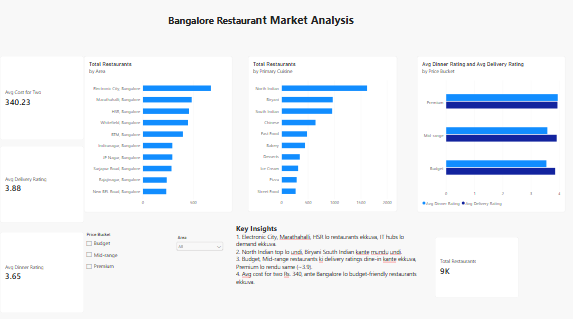

# Bangalore Restaurant Market Analysis (Power BI)

An interactive Power BI dashboard analysing Zomato restaurants in Bangalore.

## Business question
Where should a new restaurant owner open, and what cuisine and price range work best?

## Dataset
Zomato Bangalore Restaurants 2022 (Kaggle, by Sahil Vora). About 8,900 restaurant outlets with cuisine, area, cost for two, dinner and delivery ratings and review counts.

## Tools
Power BI Desktop, Power Query (data cleaning), DAX (measures).

## What I did
- Cleaned the data in Power Query: removed unused columns, replaced rating errors and "-" values with nulls, fixed data types.
- Created a Price Bucket column (Budget, Mid-range, Premium) and a Primary Cuisine column.
- Wrote DAX measures: Total Restaurants, Avg Cost for Two, Avg Dinner Rating, Avg Delivery Rating.
- Built 3 charts, 4 KPI cards and slicers (Price Bucket, Area).

## Key insights
1. Restaurants are concentrated in Electronic City, Marathahalli and HSR (IT hubs).
2. North Indian is the top cuisine; Biryani ranks ahead of South Indian.
3. Budget and Mid-range restaurants get higher delivery ratings than dine-in ratings. Premium restaurants are rated about the same for both.
4. Average cost for two is about Rs. 340.

## Dashboard

